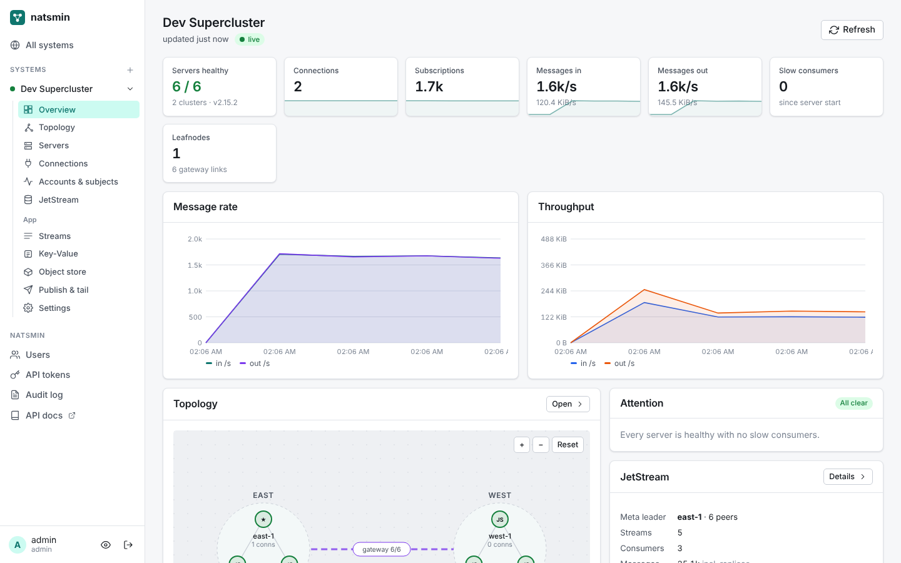
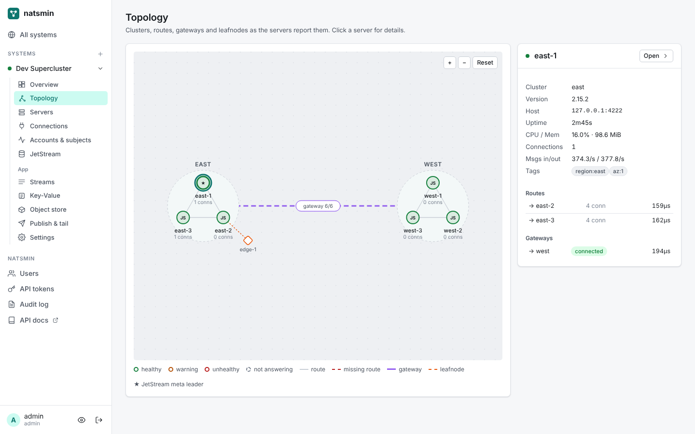
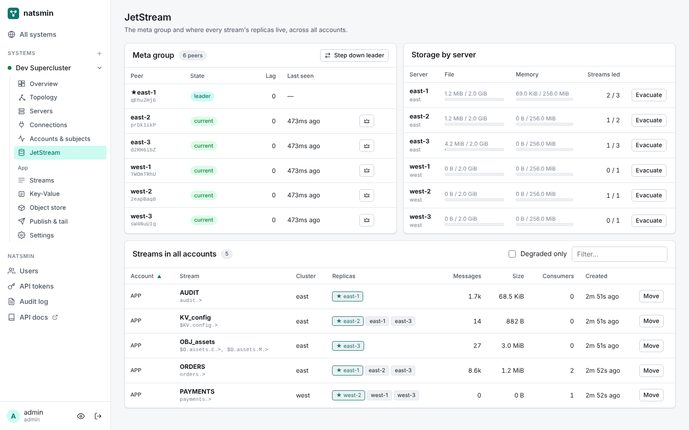
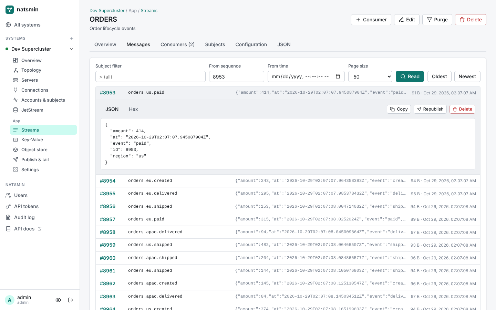
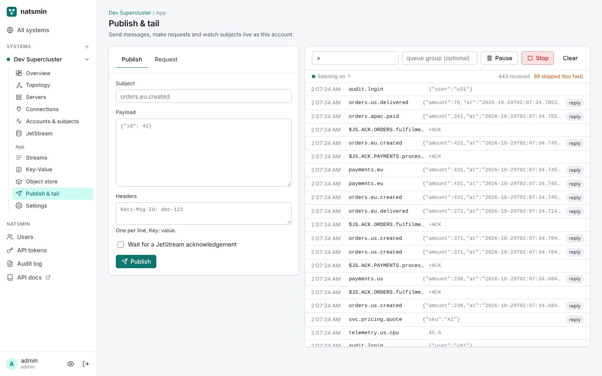

# natsmin

A management UI and HTTP API for [NATS](https://nats.io): monitor and operate servers, clusters, superclusters and leafnodes, and manage JetStream streams, consumers, Key-Value buckets and object stores.

natsmin is one Go binary with the UI built in. It talks to NATS the way the `nats` CLI does: through the system account for monitoring and maintenance, and through ordinary account users for JetStream and messaging. Nothing runs on your NATS servers.



## What it does

**See the whole system**
- Live overview: server health, connections, subscriptions, message and byte rates, slow consumers, with charts updated over server-sent events
- Topology map of clusters, routes, gateways and leafnodes. Missing routes inside a cluster and disconnected gateways are flagged.
- Server list and detail with CPU, memory, JetStream usage, and every raw monitoring endpoint (`varz`, `jsz`, `routez`, `gatewayz`, `leafz`, `accountz`, `subsz`, `raftz`, `healthz`, ...)
- Client connections across every server, filterable by server, account, user or subscribed subject, sortable by traffic, with their subscriptions
- Per-account traffic, and "who is subscribed to this subject?" across the cluster

**Run JetStream**
- Meta group peers, leader, lag; step the leader down or hand it to a chosen server
- Every stream in every account with where its replicas live, which are lagging, and storage per server
- Move a stream to another server, cluster or tag set; evacuate all replicas off a server before maintenance; remove a dead peer
- Streams: create and edit with a form or raw JSON, purge (all, by subject, keep N, up to a sequence), step down, delete
- Message browser: read by sequence, time or subject filter, view headers and JSON/text/hex payloads, republish or delete messages, per-subject counts
- Consumers: create and edit (pull or push), live backlog, pause until a time, resume, step down, delete
- Key-Value: buckets, keys, values, history and restore, optimistic concurrency, live watch
- Object store: buckets, upload by drag-and-drop, download, delete

**Messaging**
- Publish (optionally waiting for a JetStream ack) and request/reply with headers
- Live tail of any subject or wildcard in the browser

**Built for teams**
- Users with viewer, operator and admin roles; API tokens limited to a role and expiry
- An audit log of every change, through the UI or the API
- NATS credentials (passwords, tokens, `.creds` files, nkeys, TLS keys) are encrypted at rest

**API plane**

Everything the UI does is a documented HTTP API: OpenAPI 3.1 at `/api/openapi.json`, interactive docs at `/api/docs`. The UI is just one client. Scripts, CI jobs and other tools use the same API with a bearer token:

```bash
curl -H "Authorization: Bearer nm_..." http://localhost:8080/api/v1/systems/prod/jetstream/assets
```

| | |
|---|---|
|  |  |
|  |  |

## Quick start

### Try it with a local supercluster (no Docker needed)

```bash
make ui
```

```bash
go run ./cmd/natsmin-devcluster -demo
```

```bash
go run ./cmd/natsmin
```

The dev cluster starts two 3-node clusters (`east`, `west`) joined by gateways, plus a leafnode, in one process, and generates demo traffic. Open http://localhost:8080, create the admin account, and add a system with URL `nats://localhost:4222`, system account `sys` / `sys`, and an account connection `app` / `app`.

### Docker Compose

```bash
docker compose up --build
```

Starts a 3-node JetStream cluster and natsmin on http://localhost:8080 (login `admin` / `changeme`). Add the system with URL `nats://nats-1:4222`.

### Run against your own NATS

```bash
docker run -p 8080:8080 -v natsmin:/data natsmin
```

Then add a system in the UI. You need:

- **Server URLs**: one or more seed URLs; the rest of the cluster is discovered.
- **System account credentials** for topology, health, connections and maintenance. Any user in the system account works (user/password, token, `.creds`, or nkey).
- **Account connections**: one user per NATS account whose streams, KV buckets and object stores you want to manage.

Operator mode (JWT) and static config auth both work.

## Configuration

Flags or environment variables:

| Variable | Default | |
|---|---|---|
| `NATSMIN_ADDR` | `:8080` | Listen address |
| `NATSMIN_DATA` | `./data` | Database and secret key directory |
| `NATSMIN_SECRET_KEY` | | Base64 32-byte key for encrypting credentials. If unset, one is generated in the data directory. |
| `NATSMIN_ADMIN_USER`, `NATSMIN_ADMIN_PASSWORD` | | Create the first admin on startup |
| `NATSMIN_ALLOW_SETUP` | `true` | Let the first visitor create the admin when no users exist. Turn off when exposing natsmin before setup. |
| `NATSMIN_POLL_INTERVAL` | `5s` | How often each system is polled |
| `NATSMIN_SECURE_COOKIES` | `false` | Mark session cookies `Secure` (enable behind HTTPS) |
| `NATSMIN_TLS_CERT`, `NATSMIN_TLS_KEY` | | Serve HTTPS directly |
| `NATSMIN_LOG_JSON` | `false` | JSON logs |

`natsmin openapi` prints the OpenAPI document.

## Roles

| | viewer | operator | admin |
|---|:-:|:-:|:-:|
| See everything | ✓ | ✓ | ✓ |
| Streams, consumers, KV, objects: create/edit/delete; publish, tail, request; disconnect clients | | ✓ | ✓ |
| Register systems, manage users, JetStream maintenance (stepdown, moves, peer removal), config reload, audit log | | | ✓ |

## Development

Requirements: Go 1.26+, Node 22+, pnpm.

```bash
make devcluster   # terminal 1: supercluster + demo traffic
make dev          # terminal 2: API server on :8080
cd ui && pnpm install && pnpm dev   # terminal 3: UI with hot reload on :5173
```

`make test` runs the Go tests, which start real in-process NATS superclusters. `make check` runs vet, gofmt and the Svelte type checker. After changing the API, `make openapi` regenerates `docs/openapi.json` and the UI's typed client.

See [docs/architecture.md](docs/architecture.md) for how the pieces fit together, and [CONTRIBUTING.md](CONTRIBUTING.md).

## Roadmap

See [ROADMAP.md](ROADMAP.md). The next items are OIDC login, alerting rules with webhooks, account and user JWT management for operator mode, stream backup and restore, and per-system role scoping.

## License

Apache License 2.0. NATS is a trademark of the Linux Foundation. natsmin is an independent project and is not affiliated with Synadia or the NATS maintainers.
